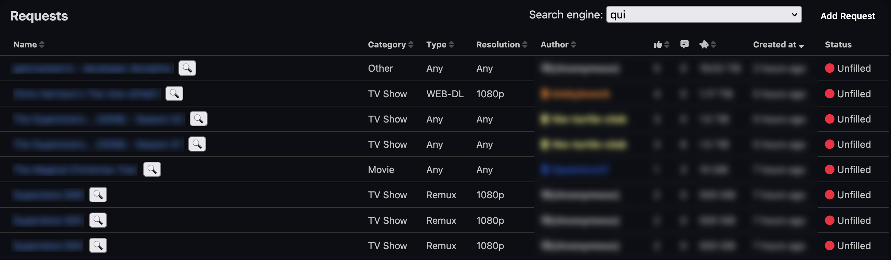
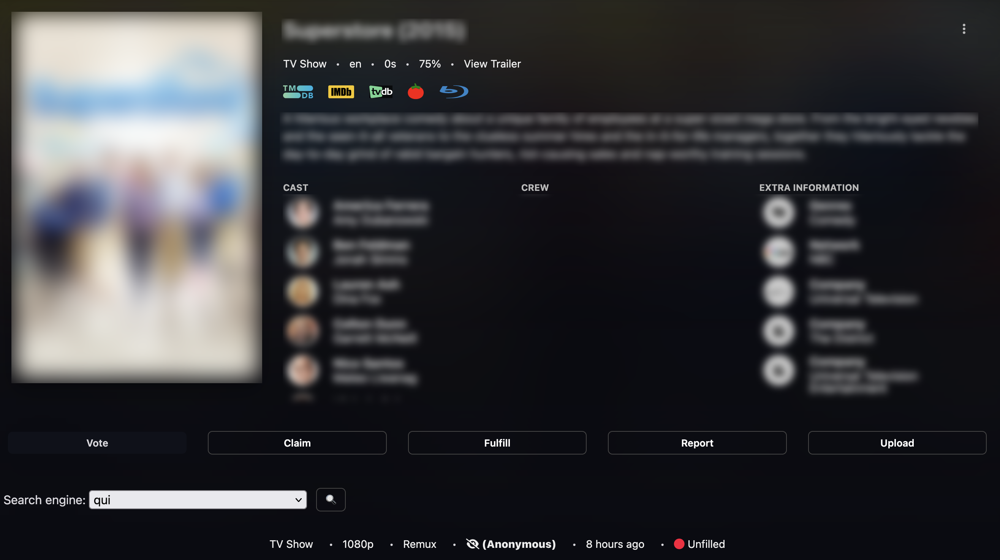
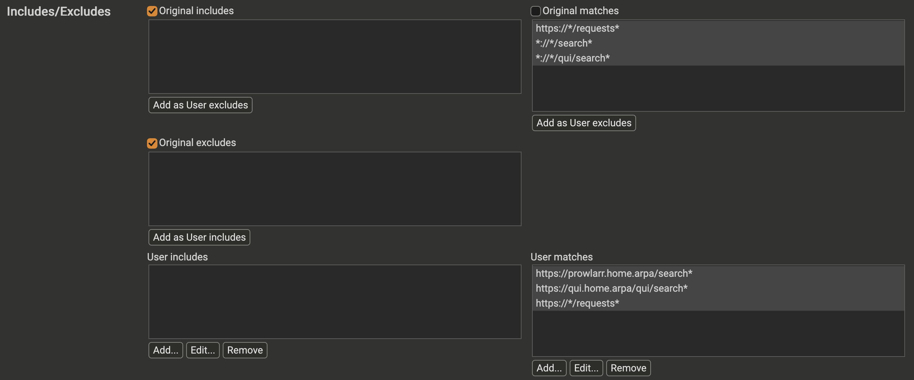
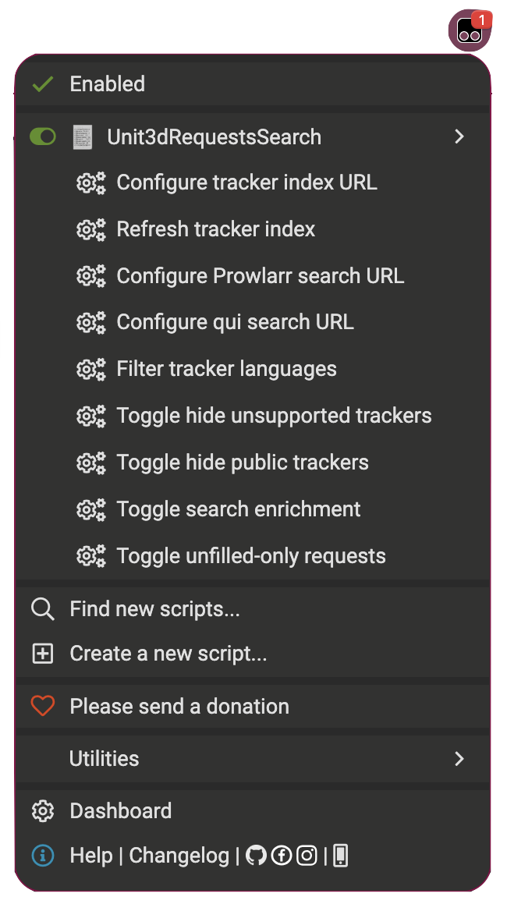

# Unit3dRequestsSearch

A Tampermonkey userscript that adds search functionality to Unit3D tracker request pages. It lets you search for unfilled requests across Prowlarr, qui, popular search engines, and individual tracker websites.




## Features

- Adds a search engine dropdown and 🔍 search buttons to the requests list and individual request pages
- Search via local Prowlarr and qui instances with category selection and autofill
- Search via public engines: TMDB, TVDB, IMDb, DuckDuckGo, Google, Bing
- Search individual tracker websites (private, semi-private & public)
- Enriches searches with request details such as title, year, IDs, season, episode, resolution, and release type when available
- Supports optional language filtering and hiding public or unsupported trackers from the dropdown
- Can automatically filter the requests overview to unfilled requests (`?unfilled=true`), with an option to disable it
- Loads and caches a shared tracker index, with manual refresh

## Installation

1. Install the [Tampermonkey](https://www.tampermonkey.net/) browser extension
2. Try installing the script automatically by opening the raw [`Unit3dRequestsSearch.user.js`](Unit3dRequestsSearch.user.js) URL. If this fails:
   1. Click the Tampermonkey icon → "Create a new script"
   2. Replace the template content with the contents of [`Unit3dRequestsSearch.user.js`](Unit3dRequestsSearch.user.js)
   3. Save the script (Ctrl+S)
   4. Visit/reload your UNIT3D tracker's requests page — the search controls should appear
3. Configure the script according to the next section

### Configuration

The script includes broad matches for request pages and search pages so it can autofill locally hosted Prowlarr and qui instances:

```js
// @match        https://*/requests*
// @match        *://*/search*
// @match        *://*/qui/search*
```

This means the script will run at any website you visit that matches those patterns. For your own safety it makes sense to limit those as much as possible.

1. Open `Tampermonkey Dashboard` → `Unit3dRequestsSearch` → `Settings`.
2. Uncheck `Original matches`. This disables *all* matches from the script header.
3. Under `User matches`, add your own patterns:
   - If your Prowlarr instance is reachable at: `http://192.168.178.50:9696` and you do not have a qui instance use:

      ```text
      https://*/requests*
      http://192.168.178.50:9696/search*
      ```

   - If your Prowlarr and qui instances are reacable at `https://prowlarr.home.arpa` and `https://qui.home.arpa/qui` use:

      ```text
      https://*/requests*
      https://prowlarr.home.arpa/search*
      https://qui.home.arpa/qui/search*
      ```

   - If you want to use the script only on one specific tracker use `https://example-tracker.com/requests*` instead of `https://*/requests*`

    

4. Save the settings.

To set a default tracker index URL in the script, edit `INDEX_URL_DEFAULT` near the top of `Unit3dRequestsSearch.user.js`. Use the raw HTTP(S) URL to `data/tracker-index.json`. A URL saved through the Tampermonkey menu takes precedence over this default.

> [!NOTE]
> Adding User matches without disabling Original matches does **not** replace the broad `*://*/search*` rule; it only adds to it. The Prowlarr and qui addresses must also match the URLs configured in the script's Tampermonkey menu.

## Menu Commands

The script provides the following Tampermonkey menu commands (click the Tampermonkey icon → script name):



| Menu command                     | Description                                                                                                         | Default                             |
| -------------------------------- | ------------------------------------------------------------------------------------------------------------------- | ----------------------------------- |
| Configure tracker index URL      | Set the raw HTTP(S) URL to your generated `tracker-index.json` (any hosting provider).                              | —                                   |
| Refresh tracker index            | Download the latest JSON index from the configured URL.                                                             | —                                   |
| Configure Prowlarr search URL    | Set your Prowlarr search address.                                                                                   | `https://prowlarr.home.arpa/search` |
| Configure qui search URL         | Set your qui search address.                                                                                        | `https://qui.home.arpa/qui/search`  |
| Filter tracker languages         | Enter comma-separated language codes such as `en,de` or `en-US`. `en` also matches `en-US`, `en-GB`, etc.           | All languages                       |
| Toggle hide unsupported trackers | Hide trackers without a search rule from the dropdown.                                                              | OFF                                 |
| Toggle hide public trackers      | Hide public trackers from the dropdown.                                                                             | OFF                                 |
| Toggle search enrichment         | Fetch and parse request details before searching.                                                                   | ON                                  |
| Toggle unfilled-only requests    | Automatically add `?unfilled=true` to the requests overview URL. Disabling this does not remove an existing filter. | ON                                  |

## How It Works

1. **Requests overview**: On `/requests` (including URLs with filters such as `?unfilled=true`), the script adds a search engine dropdown and a 🔍 button to each request row. With **Toggle unfilled-only requests** enabled, the overview is redirected to a URL with `unfilled=true` if that filter is not already set. The dropdown selection is remembered.

2. **Request details and enrichment**: On `/requests/12345`, the dropdown and search button appear in the request action menu. The script reads the title, year, category, resolution, release type, and available IMDb/TMDB/TVDb/TVMaze IDs and other metadata from the page. When a button in the overview is clicked, the script can fetch that request's detail page in the background and use the same metadata. If fetching fails, it searches using the overview information instead. Enrichment can be disabled from the menu.

3. **Search queries**: Available metadata can normalize titles (for example, a season request can become `S02`) and enrich searches. Prowlarr supports category-specific Movie, TV, Music, and Book query tokens, such as `{ImdbId:tt0120800}{Year:1998}{TmdbId:18937}`. qui selects Movies, TV, Music, Books & comics, Apps & games, or Adult, and fills supported Advanced fields. Other destinations use the normalized title and, where supported, dedicated URL parameters from their tracker definitions. Missing metadata fields are omitted.

4. **Prowlarr and qui autofill**: Local searches open the configured page with the search information in a URL hash. The userscript running on that page selects the relevant search category/type, fills the available fields, and submits the search. These integrations depend on the current Prowlarr and qui page structure.

5. **Tracker definitions**: The separate Python generator requires Python 3.12+ and PyYAML. It reads Prowlarr's indexer YAML definitions and builds `data/tracker-index.json`. It merges variants of the same website by hostname, extracts language, privacy, codebase, categories, and usable browser-search rules. If a definition requires an API or cannot provide a browser search, the generator uses a codebase default where available; `data/tracker-overrides.json` supplies individual corrections and extra trackers. The userscript reads only the generated JSON index, not the YAML files.

6. **Caching**: The shared tracker index is stored in Tampermonkey's storage and reused until you manually refresh it or configure a different index. It does **not** expire automatically after seven days.

## Tracker Compatibility

View the full [tracker compatibility table](docs/TRACKERS.md) here. You can help improve the compatibility by reporting searches you have actually tested. Use the corresponding issue template, or submit a pull request with the relevant JSON change:

- **[Tracker compatibility report](./.github/ISSUE_TEMPLATE/tracker-compatibility.md)** — Report whether a tracker's browser search works and which of the eight categories work. Test outcomes go in `data/tracker-tests.json`, keyed by the tracker's hostname (without `www.`). Use `passed`, `failed`, or `untested`; do not mark an untested category as failed.
- **[Tracker override](./.github/ISSUE_TEMPLATE/tracker-override.md)** — Report a missing tracker or a search URL that needs correcting. Tracker-specific search rules belong in `data/tracker-overrides.json`.
- **[Codebase default](./.github/ISSUE_TEMPLATE/codebase-default.md)** — Propose a search rule shared by sites using the same codebase (for example UNIT3D or NexusPHP). These belong in `data/codebase-defaults.json`; site-specific exceptions should be overrides instead.

Please **do not include passkeys, API keys, session cookies, or other credentials**. Also follow tracker rules regarding sharing such information publicly. Pull requests can use the [contribution template](./.github/pull_request_template.md).

Test results are recorded independently of generated search rules: a search URL appearing in the compatibility table does not mean it has been verified.

## Disclaimer

This project was realised with the help of LLMs.
